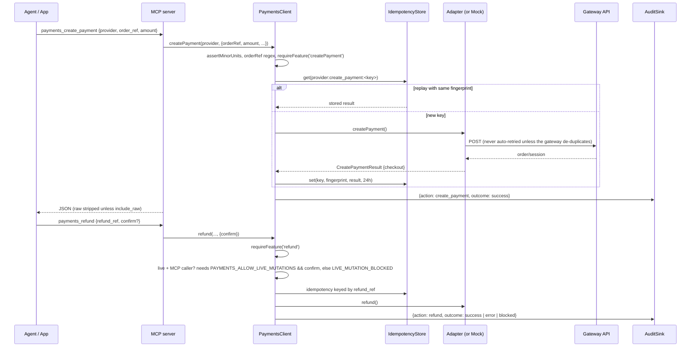

# Architecture

This document covers deliverables A (overview), B (team responsibilities), D (unified MCP tool schema), E (provider adapter design), K (deployment) and M (repository structure). Every statement describes code that exists in `src/`. Planned work is in [roadmap.md](roadmap.md).

---

## A. Architecture overview

### Layers

```
                    ┌──────────────────────────────┐     ┌──────────────────────────────┐
  AI agents         │ Claude Code / Desktop, Cursor │     │ ChatGPT connector, remote    │
                    │ (stdio)                       │     │ agents (Streamable HTTP)     │
                    └───────────────┬──────────────┘     └───────────────┬──────────────┘
                                    │                                    │ Bearer MCP_HTTP_TOKEN
                    ┌───────────────▼────────────────────────────────────▼──────────────┐
  src/cli.ts        │ CLI: stdio (default) | http (/mcp, /healthz) | doctor             │
                    └───────────────────────────────┬───────────────────────────────────┘
                    ┌───────────────────────────────▼───────────────────────────────────┐
  src/mcp/server.ts │ MCP server: 19 tools, 2 resources, 1 prompt. zod schemas,         │
                    │ snake_case args -> camelCase SDK calls, `raw` stripped by default  │
                    └───────────────────────────────┬───────────────────────────────────┘
  Your app ───────────────────────────────────────► │  (SDK users call PaymentsClient directly)
                    ┌───────────────────────────────▼───────────────────────────────────┐
  src/client.ts     │ PaymentsClient (orchestrator)                                     │
                    │  validate (paise, orderRef regex) -> feature gate (capabilities)  │
                    │  -> live rail (MCP only) -> idempotency -> audit -> adapter       │
                    └──────┬──────────────────────────┬───────────────────────────┬─────┘
                           │ mode=mock                │ mode=sandbox|live         │
                    ┌──────▼────────┐   ┌─────────────▼─────────────────────────┐ │
  src/mock          │ MockGateway   │   │ Provider adapters (src/providers/*)   │ │
                    │ + MockLedger  │   │ razorpay payu cashfree ccavenue paytm │ │
                    │ (no network)  │   │ phonepe stripe skydo                  │ │
                    └───────────────┘   └─────────────┬─────────────────────────┘ │
                                        ┌─────────────▼──────────────┐   ┌────────▼─────────┐
  src/core                              │ HttpClient: timeout, safe  │   │ AuditSink        │
                                        │ retries, error mapping,    │   │ IdempotencyStore │
                                        │ redacted logs (stderr)     │   │ Logger           │
                                        └─────────────┬──────────────┘   └──────────────────┘
                                                      ▼
                                       Gateway APIs (HTTPS, server-side secrets)

  src/webhooks/handler.ts: verify (adapter.parseWebhook) -> dedupe (WebhookDedupeStore) -> onEvent -> HTTP status
```

### Request lifecycle (create, then refund)



### Design principles

1. **One contract, honest gaps.** Every adapter implements `PaymentGateway` (`src/core/gateway.ts`). Each also ships a `ProviderCapabilities` map whose `features` classify every feature as `supported`, `partial`, `not_implemented` or `unsupported`. `PaymentsClient.requireFeature` checks the map **before** any network call. A missing feature fails fast with `UNSUPPORTED` (the gateway lacks it) or `NOT_IMPLEMENTED` (we lack it).
2. **Integer paise everywhere.** Adapters convert to the gateway's format: rupee strings for PayU/Paytm/CCAvenue, rupee numbers for Cashfree, paise for Razorpay/PhonePe/Stripe. `src/core/money.ts` has `toMajorString` and `fromMajor`.
3. **`orderRef` is the merchant's key.** Adapters send it to the gateway (Razorpay `receipt` + `notes.order_ref`, Cashfree `order_id`, PhonePe `merchantOrderId`, ...) and map gateway ids back to it.
4. **Four checkout shapes.** `js_sdk`, `redirect`, `form_post`, `manual`. A frontend that handles these four handles every gateway.
5. **Verification is explicit about how it verified.** `verifiedVia` is one of `signature`, `status_api`, `decryption` or `manual_record`. Gateways with unsigned redirects (PhonePe, Cashfree, Stripe) are verified by calling the status API. CCAvenue's decrypted result is re-confirmed through the status API. Skydo has no callback: it reads the Zoho invoice (`status_api`) or the ledger entry you recorded (`manual_record`). `PaymentsClient` adds `paid`, which is true only when the result is valid, the status is settled, and the caller passed both `orderRef` and `expectedAmount`.
6. **Nothing hidden.** Every result carries `raw` (the untouched gateway response). The MCP layer strips it by default to save agent context, and `include_raw: true` brings it back.
7. **Mock mode is a first-class gateway.** It's not a stub. `MockGateway` keeps the real capability map, signs callbacks and webhooks with HMAC, tracks refund balances, and shares one `MockLedger` across tool calls.

---

## B. Agent / team responsibilities

This repository was designed and built by a team of specialised agents with a human owner. The table records who owns what, so changes go to the right reviewer. When you contribute, apply the matching lens to your own PR.

| Role | Owns | Files | Review question they always ask |
|---|---|---|---|
| **Product architect** | Scope, feature taxonomy (`FEATURE_KEYS`), support levels, docs, README, roadmap | `src/core/capabilities.ts`, `docs/*`, `README.md` | "Will a developer or an agent misread what this gateway can do?" |
| **Backend architect** | Unified types, `PaymentGateway` contract, `PaymentsClient` orchestration, config loading, error model | `src/core/types.ts`, `src/core/gateway.ts`, `src/core/errors.ts`, `src/core/config.ts`, `src/client.ts`, `src/index.ts` | "Does this fit every gateway, or just the one in front of me?" |
| **Payments integration** | One adapter + capability map per gateway, gateway research with sources | `src/providers/<id>/*`, `docs/research/gateway-api-facts.md` | "Which official doc page says so? Is it marked VERIFIED?" |
| **Security** | Signature checks, constant-time compare, redaction, live-mutation rails, HTTP transport auth, threat model | `src/core/crypto.ts`, `src/core/logger.ts` (redaction), `src/core/audit.ts`, `src/cli.ts` (`bearerOk`), `docs/security.md`, `SECURITY.md` | "What happens if an agent is prompt-injected into calling this?" |
| **QA** | Test strategy, fake fetch harness, contract tests per adapter, mock-mode flows, signature round-trips | `test/*`, `docs/testing.md` | "Is there a test asserting the exact bytes we send and the exact bytes we verify?" |
| **DX** | MCP tool naming and descriptions, CLI `doctor`, code generator, examples, Claude Skill, ChatGPT kit | `src/mcp/server.ts`, `src/codegen/*`, `examples/*`, `skills/*`, `chatgpt/*` | "Can someone go from zero to a working checkout without reading gateway docs?" |
| **Reliability** | HTTP client retries/timeouts, idempotency, webhook dedupe, reconciliation guidance | `src/core/http.ts`, `src/core/idempotency.ts`, `src/webhooks/handler.ts`, `docs/reliability.md` | "If this request times out halfway, can money move twice?" |
| **Reviewer** | Cross-cutting critique of the design. Each challenge gets a recorded revision | `docs/design-review.md` | "What breaks at the edges?" |

---

## D. Unified MCP tool schema

Conventions for all tools:

- Arguments are `snake_case`. The SDK equivalents are `camelCase` on `PaymentsClient`.
- `provider` ∈ `razorpay | payu | cashfree | ccavenue | paytm | phonepe | stripe | skydo`.
- `paise`: a positive integer (`z.number().int().positive()`).
- `ref` (order_ref, refund_ref, subscription_ref): `^[A-Za-z0-9_-]{3,40}$`.
- `include_raw` (optional boolean): keeps the provider's raw response in the output.
- **Success**: one text content block containing pretty JSON. Mock-mode `payments_create_payment` prefixes it with a one-line note.
- **Failure**: `isError: true`, and the text is `PaymentError.toJSON()`:

  ```json
  { "error": "<PaymentErrorCode>", "message": "...", "retryable": false,
    "provider": "razorpay", "httpStatus": 400, "providerCode": "...", "providerMessage": "...", "hint": "..." }
  ```

  `retryable` is true only for `PROVIDER_UNAVAILABLE`, `NETWORK`, `TIMEOUT` and `RATE_LIMITED`. Schema violations (for example a malformed `order_ref`) are rejected by the MCP SDK's zod validation before reaching the client.

Error codes: `CONFIG_MISSING`, `CONFIG_INVALID`, `VALIDATION`, `UNSUPPORTED`, `NOT_IMPLEMENTED`, `AUTH`, `PROVIDER_ERROR`, `PROVIDER_UNAVAILABLE`, `NETWORK`, `TIMEOUT`, `OUTCOME_UNKNOWN`, `RATE_LIMITED`, `SIGNATURE_INVALID`, `LIVE_MUTATION_BLOCKED`, `IDEMPOTENCY_CONFLICT`, `NOT_FOUND`.

`OUTCOME_UNKNOWN` means a request that is not safe to retry (an order creation or refund POST the gateway does not de-duplicate) timed out, lost its connection, or got a 5xx: it may or may not have happened. Look the payment or refund up with the status tools before retrying.

### Discovery

| Tool | Args | Returns | Annotations |
|---|---|---|---|
| `payments_list_providers` | none | `{ mode, providers: [{ id, name, summary, configured, features: { <FeatureKey>: SupportLevel } }] }`. `configured` is always `true` in mock mode | readOnly |
| `payments_get_capabilities` | `provider` | `ProviderCapabilities`: `{ provider, displayName, website, docsUrl, dashboardUrl?, summary, features: { <FeatureKey>: { support, notes? } }, paymentMethods[], currencies, checkoutTypes[], providerAmountFormat, credentials: [{ env, key, required, secret, description }], constraints[], officialSdks{}, platformPlugins{}, lastVerified }` | readOnly |
| `payments_check_config` | `provider?` | `{ mode, allowLiveMutations, auditLog, providers: [{ provider, ready, missing[], present[], optionalMissing[], initError? }] }`. Lists env var **names** only. `initError` appears when credentials exist but the adapter rejects them (for example a live key in sandbox) | readOnly |
| `payments_recommend_gateway` | `needs: ("subscriptions"\|"international"\|"upi"\|"refunds"\|"settlements"\|"shopify"\|"woocommerce"\|"mobile_sdk"\|"webhooks"\|"exporter_collections"\|"fast_integration")[]` (most important first), `business?` | `{ ranking: [{ provider, name, score, matches[], blockers[], summary, constraints[≤3] }], note }`. A heuristic built from capability maps plus small documented priors | readOnly |

`FeatureKey` ∈ `createPayment, verifyPayment, paymentStatus, refund, refundStatus, webhooks, customers, subscriptions, settlements, payouts, paymentLinks`.

### Payments

| Tool | Args | Returns | Annotations |
|---|---|---|---|
| `payments_create_payment` | `provider`, `order_ref`, `amount` (paise; minor units of `currency`), `currency?` (ISO 4217, default INR; required for Skydo, which rejects INR), `customer?: { id?, name?, email?, phone? }`, `description?` (≤255), `return_url?`, `notify_url?`, `metadata?: Record<string,string>`, `idempotency_key?` (≤64, default `order_ref`), `provider_options?: Record<string,unknown>` (merged into the gateway request; keys that carry the amount, currency, order id, credentials, hashes or redirect URLs are rejected with `VALIDATION`), `include_raw?` | `CreatePaymentResult`: `{ provider, environment: "sandbox"\|"live", orderRef, providerOrderId, status, amount, currency, checkout: CheckoutAction, expiresAt?, raw? }` | idempotent, openWorld |
| `payments_verify_payment` | `provider`, `payload: Record<string,string>` (callback fields exactly as received; `{}` for Skydo), `order_ref` (required), `expected_amount` (required), `provider_order_id?` (the id you stored from create; recommended, and used by Razorpay to compute the signature), `include_raw?` | `VerifyPaymentResult`: `{ valid, paid, status, orderRef?, providerOrderId?, providerPaymentId?, amount?, reason?, verifiedVia: "signature"\|"status_api"\|"decryption"\|"manual_record", raw? }`. An invalid signature returns `valid: false` with a `reason`. It does not throw. **Fulfil only when `paid` is `true`** | readOnly, openWorld |
| `payments_get_status` | `provider`, `order_ref`, `provider_order_id?` (Razorpay requires it), `include_raw?` | `PaymentStatusResult`: `{ provider, orderRef, providerOrderId?, providerPaymentId?, status, amount?, amountRefunded?, currency?, method?, failureReason?, raw? }` | readOnly, openWorld |
| `payments_refund` | `provider`, `order_ref`, `refund_ref`, `provider_payment_id?` (required by Razorpay, PayU, Paytm, CCAvenue, Stripe), `amount?` (omit = full), `reason?` (≤255), `speed?: "normal"\|"instant"`, `confirm?`, `include_raw?` | `RefundResult`: `{ provider, refundRef, providerRefundId?, status: "pending"\|"processed"\|"failed"\|"unknown", amount?, raw? }` | **destructive**, idempotent, openWorld |
| `payments_get_refund_status` | `provider`, `refund_ref`, `order_ref?`, `provider_refund_id?`, `provider_payment_id?`, `include_raw?` | `RefundResult` | readOnly, openWorld |

`CheckoutAction` is one of:

```ts
{ type: 'redirect'; url: string; method: 'GET' }
{ type: 'form_post'; url: string; fields: Record<string, string> }   // auto-submit an HTML form
{ type: 'js_sdk'; sdk: 'razorpay' | 'cashfree' | 'stripe' | 'paytm'; scriptUrl: string; options: Record<string, unknown> } // publishable values only
{ type: 'manual'; instructions: string; url?: string }                // mock mode; Skydo (transfer instructions, Zoho invoice url)
```

`PaymentStatus` ∈ `created, pending, authorized, captured, failed, cancelled, expired, refunded, partially_refunded, unknown`. **`captured` means success.** `authorized` means the payment isn't final yet (manual-capture card flows, or a Razorpay signature verified before auto-capture runs).

### Webhooks

| Tool | Args | Returns | Annotations |
|---|---|---|---|
| `payments_verify_webhook` | `provider`, `headers: Record<string,string>`, `raw_body: string` (exact bytes as received), `include_raw?` | `NormalizedWebhookEvent`: `{ provider, id (dedupe key), type, providerEventType, orderRef?, providerOrderId?, providerPaymentId?, providerRefundId?, refundRef?, status?, amount?, currency?, occurredAt?, raw? }`. A bad signature returns `SIGNATURE_INVALID` | readOnly |
| `payments_simulate_webhook` | `provider`, `type: "payment.succeeded"\|"payment.failed"\|"refund.processed"`, `order_ref`, `amount`, `currency?`, `provider_payment_id?`, `refund_ref?`, `target_url?` | `{ provider, headers, rawBody, description, curl? }`. In sandbox it's signed with the gateway's real scheme and your webhook secret. In mock it uses the generic `x-mock-signature`. Live mode returns `LIVE_MUTATION_BLOCKED` | readOnly |

Normalized `type` ∈ `payment.succeeded, payment.failed, payment.pending, payment.authorized, refund.processed, refund.failed, subscription.activated, subscription.charged, subscription.halted, subscription.cancelled, dispute.created, settlement.processed, unknown`. See [webhooks.md](webhooks.md).

### Customers, subscriptions, settlements

| Tool | Args | Returns | Annotations |
|---|---|---|---|
| `payments_create_customer` | `provider`, `name?`, `email?`, `phone?`, `metadata?` | `{ provider, providerCustomerId }` (raw always stripped) | openWorld |
| `payments_create_subscription` | `provider`, `subscription_ref`, `provider_plan_id?` **or** `plan?: { name, amount, currency?, interval: "day"\|"week"\|"month"\|"year", interval_count? }`, `customer?`, `provider_customer_id?`, `total_count?` (Razorpay requires it), `return_url?`, `metadata?`, `provider_options?`, `include_raw?` | `SubscriptionResult`: `{ provider, subscriptionRef, providerSubscriptionId, status: "created"\|"pending_authorization"\|"active"\|"halted"\|"cancelled"\|"completed"\|"unknown", checkout?, raw? }` | openWorld |
| `payments_cancel_subscription` | `provider`, `provider_subscription_id`, `at_cycle_end?`, `confirm?` | `SubscriptionResult` (raw stripped) | **destructive**, openWorld |
| `payments_list_settlements` | `provider`, `from?` (YYYY-MM-DD), `to?`, `count?` (≤100) | `{ provider, items: [{ id, amount, currency, status, utr?, settledAt?, fees?, tax? }] }` | readOnly, openWorld |

### Developer experience

| Tool | Args | Returns | Annotations |
|---|---|---|---|
| `payments_generate_integration` | `provider`, `framework` ∈ `express, nextjs, fastify, react, html, react-native, flutter, shopify, other` (`FRAMEWORKS` in `src/codegen/index.ts`), `features?: ("checkout"\|"webhooks"\|"refunds"\|"subscriptions")[]` (default checkout + webhooks) | Generated files (paths + contents), env template and test checklist for the agent to write | readOnly |
| `payments_mock_complete_payment` | `provider`, `order_ref`, `outcome: "success"\|"failure"`, `method?` (default `upi`) | `{ payment, callbackPayload }`. Feed `callbackPayload` to `payments_verify_payment`. Fails with `VALIDATION` outside mock mode or if the payment is already final | not readOnly |

### Skydo

Skydo has no API; see [skydo.md](skydo.md). These two tools work in `sandbox` and `live` mode only (mock mode returns `VALIDATION`; simulate Skydo with `payments_mock_complete_payment`).

| Tool | Args | Returns | Annotations |
|---|---|---|---|
| `payments_skydo_record_payment` | `order_ref`, `amount_received` (positive integer, minor units of the invoice currency), `received_at?` (ISO date/time, default now), `fira_number?` (≤100), `note?` (≤500) | `PaymentStatusResult` for the ledger entry: `status` is `captured` once receipts reach the amount, else `pending`; `failureReason` shows received vs expected; `raw` is the ledger entry. Ledger mode only: `VALIDATION` with the Zoho bridge. Each call adds a receipt (not idempotent). Audited as `skydo_record_payment` | not readOnly, not idempotent |
| `payments_skydo_outstanding` | none | `{ mode: "ledger"\|"zoho", outstanding: LedgerEntry[], note? }`: ledger entries with status `created` or `pending`, oldest first. In Zoho mode `outstanding` is empty and `note` points to Zoho Books | readOnly |

SDK equivalents: `PaymentsClient.skydoRecordPayment({ orderRef, amountReceived, receivedAt?, firaNumber?, note? })` and `PaymentsClient.skydoOutstanding()`.

### Resources and prompts

| URI / name | Type | Content |
|---|---|---|
| `payments://matrix` | resource, `text/markdown` | Support matrix generated from every capability map (`src/codegen/matrix.ts`) |
| `payments://providers/{provider}` | resource template, `application/json` | Same as `payments_get_capabilities` |
| `integrate_payments` | prompt, args `provider`, `framework` | Five-step plan: capabilities → generate → env → mock then sandbox test → report dashboard tasks |

---

## E. Provider adapter design

### The two halves of a provider

Each gateway lives in `src/providers/<id>/` and exports a `ProviderModule`:

```ts
export interface ProviderModule<C> {
  id: ProviderId;
  capabilities: ProviderCapabilities;                 // facts, in capabilities.ts
  create(credentials: C, ctx: AdapterContext): PaymentGateway;  // validates creds, returns the adapter
  extractError?(data: unknown, status: number): { code?: string; message?: string };
}
```

- **`capabilities.ts` is data, not code.** It holds the support level and notes per feature, payment methods, currencies, checkout types, the gateway's amount format, credential specs (env var ↔ credential key), blunt constraints, official SDKs, platform plugins and a `lastVerified` date. Config loading, `doctor`, `payments_check_config`, the generated matrix, the recommender and mock mode all read from it. Adding a gateway never touches `config.ts`.
- **`adapter.ts` is the translation.** It turns unified input into the gateway's request and the gateway's response into unified output. Required methods: `createPayment`, `verifyPayment`, `getPaymentStatus`, `parseWebhook`. Optional methods are implemented only when the feature is real: `refund`, `getRefundStatus`, `createCustomer`, `createSubscription`, `cancelSubscription`, `listSettlements`, `simulateWebhook`.

`AdapterContext` is injected: `{ environment, http, logger, now }`. Adapters never call `fetch` directly. They call `ctx.http.request({ method, url, headers, body, operation, retrySafe })`, which gives them timeouts, safe retries, error mapping and redacted logs for free. Tests inject a fake fetch through the same path (`test/helpers.ts`).

### Rules every adapter follows

1. **Validate credentials in `create()`.** Throw `CONFIG_MISSING` with the env var names, and `CONFIG_INVALID` when key prefixes contradict the mode (see Razorpay's `rzp_test_` / `rzp_live_` checks).
2. **Convert amounts at the boundary.** Accept paise and send what the gateway wants. When the gateway signs the amount string (PayU), sign the exact string you send.
3. **Mark POSTs `retrySafe: true` only when the gateway de-duplicates them.** That means an idempotency header or a merchant-supplied unique id such as `refund_id`. Razorpay order creation is never retried. Razorpay customer creation (`fail_existing: "0"`) and cancellation are.
4. **Compare signatures with `safeEqual`** (constant time, never throws). Verify webhooks over `rawBody`, never over re-serialized JSON.
5. **`verifyPayment` returns `valid: false` with a `reason` for bad input. It doesn't throw.** If the callback isn't signed, call the status API and set `verifiedVia: 'status_api'`. When `orderRef` / `expectedAmount` are given, enforce them.
6. **`parseWebhook` throws `SIGNATURE_INVALID`** on a bad signature, `CONFIG_MISSING` if the webhook secret is absent, and returns a stable `id` for dedupe. Prefer the gateway's event id header and fall back to a deterministic composite.
7. **Map statuses conservatively.** Return `unknown` rather than guess. Don't return `captured` unless the gateway says the money is collected.
8. **Put the untouched gateway response in `raw`.**
9. **`simulateWebhook` must round-trip:** `parseWebhook(await simulateWebhook(x))` succeeds with the configured secret.
10. **Every fact in `capabilities.ts` traces to `docs/research/gateway-api-facts.md`** with a source and a VERIFIED / PARTIAL / UNVERIFIED tag, and is re-checked against the official docs in `docs/research/verification/`.

### How to add a provider

1. Research first. Add a section to `docs/research/gateway-api-facts.md`: base URLs, auth, create, status, refund, refund status, callback signature, webhook signature, amount unit, ID constraints. Cite official pages and tag every row.
2. Add the id to `PROVIDER_IDS` in `src/core/types.ts`. If the gateway needs a new browser SDK, extend `CheckoutAction['sdk']`.
3. Create `src/providers/<id>/capabilities.ts`. Fill every `FEATURE_KEYS` entry. Use `unsupported` only when the gateway lacks the feature, and `not_implemented` when we do.
4. Create `src/providers/<id>/adapter.ts` that exports `const <id>: ProviderModule<Creds>`, and register it in `src/providers/index.ts`.
5. Add tests in `test/providers/<id>.test.ts` using `fakeFetch` + `testContext`. They should assert the exact request (URL, headers, body, hash input), cover signature verification with a known vector from the gateway docs, include a tamper test, map every status, and round-trip the webhook simulation.
6. Add the env vars to `.env.example`, then update `docs/gateway-matrix.md` and the README matrix.
7. Run `PAYMENTS_MODE=mock npm run doctor` and `npm test`.

The checklist is repeated, with PR expectations, in [CONTRIBUTING.md](../CONTRIBUTING.md).

### Why not wrap official SDKs?

The official Node SDKs vary in quality and maintenance, pull in heavy dependency trees, and some (Paytm checksum, CCAvenue kit) are copy-paste files rather than packages. Plain `fetch` plus `node:crypto` keeps the package to two runtime dependencies (`@modelcontextprotocol/sdk`, `zod`) and makes every byte sent auditable in tests. The cost is that we track API drift ourselves. See [risks.md](risks.md).

---

## K. Deployment

### 1. stdio, local (default and recommended)

The MCP client spawns the server as a child process. Nothing listens on a port.

```bash
claude mcp add india-payments \
  -e PAYMENTS_MODE=sandbox -e RAZORPAY_KEY_ID=rzp_test_xxx -e RAZORPAY_KEY_SECRET=xxx \
  -- npx -y india-payments-mcp
```

- stdout carries the MCP protocol. All logs go to **stderr** as JSON.
- Credentials live in the client's MCP config or the user's environment. Prefer test keys locally. For live keys on a laptop, use a secrets manager wrapper (below) rather than plaintext config.

### 2. Streamable HTTP (remote agents, ChatGPT connectors)

```bash
MCP_HTTP_TOKEN=$(openssl rand -hex 32) PAYMENTS_MODE=sandbox npx india-payments-mcp http
# -> listening on http://127.0.0.1:8787/mcp
```

What the built-in server does:

- `POST/GET/DELETE /mcp` requires `Authorization: Bearer <MCP_HTTP_TOKEN>`. The token is compared in constant time and must be at least 24 characters, or the server refuses to start. Missing or wrong tokens get `401`.
- `GET /healthz` is unauthenticated and returns `{ ok, version, mode }`.
- It binds `127.0.0.1:8787` by default (`MCP_HTTP_HOST`, `MCP_HTTP_PORT`).
- MCP sessions are tracked in memory by `mcp-session-id`. One `PaymentsClient` is shared by all sessions in the process, so the in-memory idempotency store and mock ledger are shared too.

What it does **not** do (put these in front of it):

- **TLS.** Terminate at a reverse proxy (Caddy, nginx, a cloud load balancer).
- **Per-user identity / OAuth.** There's one shared bearer token. Treat it as a service credential. If several humans need access, put an authenticating proxy (OAuth2 Proxy, Cloudflare Access, an API gateway) in front and give each environment its own token.
- **Rate limiting and IP allowlists.** Configure these at the proxy.
- **Horizontal scaling.** Sessions are per-process, so use sticky sessions on `mcp-session-id`, or run one replica. For more than one replica, back idempotency with a shared store first ([roadmap](roadmap.md)).

Example Caddy config:

```caddyfile
payments-mcp.example.com {
  @mcp path /mcp*
  reverse_proxy @mcp 127.0.0.1:8787
  respond /healthz 404
}
```

nginx needs buffering turned off for the streaming responses:

```nginx
location /mcp {
  proxy_pass http://127.0.0.1:8787;
  proxy_http_version 1.1;
  proxy_set_header Connection "";
  proxy_buffering off;
  proxy_read_timeout 300s;
}
```

### 3. Docker

The `Dockerfile` is multi-stage on `node:22-alpine`, runs as the non-root `node` user, sets `MCP_HTTP_HOST=0.0.0.0` inside the container, and exposes 8787 with a `/healthz` healthcheck.

```bash
docker build -t india-payments-mcp .
docker run --rm -p 127.0.0.1:8787:8787 \
  --env-file ./.env \
  -e MCP_HTTP_TOKEN="$(openssl rand -hex 32)" \
  --read-only --cap-drop ALL --security-opt no-new-privileges \
  india-payments-mcp
```

To write an audit log from a read-only container, mount a volume and point `PAYMENTS_AUDIT_LOG` at it: `-v payments-audit:/audit -e PAYMENTS_AUDIT_LOG=/audit/audit.jsonl`.

### 4. Secrets managers

The server only reads environment variables, so any manager that injects env vars at process start works. Nothing is written to disk.

| Manager | Pattern |
|---|---|
| 1Password CLI | `op run --env-file=.env.1p -- npx india-payments-mcp` with `RAZORPAY_KEY_SECRET=op://Payments/Razorpay/secret` |
| Doppler | `doppler run -- npx india-payments-mcp http` |
| AWS | ECS task definition `secrets` from Secrets Manager / SSM Parameter Store, mapped to env var names |
| GCP | Cloud Run `--set-secrets RAZORPAY_KEY_SECRET=razorpay-key-secret:latest` |
| Kubernetes | `envFrom: secretRef` (ideally synced by External Secrets Operator from Vault/AWS/GCP) |
| HashiCorp Vault | Vault Agent template rendering an env file consumed by the process supervisor |

Keep **separate secrets per environment** (sandbox and live in different vaults/projects). Give the live deployment only the gateways it uses (`PAYMENTS_PROVIDERS`). See [security.md](security.md).

---

## M. Repository structure

```
india-payments-mcp/
├── src/
│   ├── index.ts                 Public SDK exports
│   ├── version.ts
│   ├── cli.ts                   stdio server | `http` | `doctor`
│   ├── client.ts                PaymentsClient: orchestration, rails, idempotency, audit
│   ├── core/
│   │   ├── types.ts             Unified inputs/outputs, statuses, CheckoutAction, webhook events
│   │   ├── gateway.ts           PaymentGateway + ProviderModule + AdapterContext contracts
│   │   ├── capabilities.ts      FEATURE_KEYS, SupportLevel, ProviderCapabilities
│   │   ├── config.ts            Env -> PaymentsConfig, credential reports (names only)
│   │   ├── errors.ts            PaymentError, codes, retryable set, HTTP status mapping
│   │   ├── http.ts              fetch wrapper: timeout, safe retries, Retry-After, error mapping
│   │   ├── idempotency.ts       IdempotencyStore (pluggable), fingerprinting, withIdempotency
│   │   ├── audit.ts             AuditSink: JSONL file, memory, noop
│   │   ├── logger.ts            stderr JSON logger + key-based redaction
│   │   ├── crypto.ts            HMAC/SHA helpers, constant-time compare, header lookup
│   │   └── money.ts             paise <-> major-unit conversion, validation
│   ├── providers/
│   │   ├── index.ts             Registry: PROVIDERS, allCapabilities()
│   │   └── <id>/capabilities.ts, adapter.ts (+ helpers such as paytm/checksum.ts, stripe/form.ts,
│   │                                skydo/zoho.ts, skydo/accounts.ts, skydo/ledger.ts)
│   ├── mock/mock-gateway.ts     MockGateway + MockLedger
│   ├── webhooks/handler.ts      createWebhookHandler, WebhookDedupeStore
│   ├── mcp/server.ts            Tools, resources, prompts
│   └── codegen/                 Integration generator, recommender, support matrix
├── test/                        vitest suites, fakeFetch/testContext helpers, stdio/HTTP end-to-end tests
├── scripts/sandbox-smoke.ts     smoke test against real gateway sandboxes (npm run sandbox:smoke)
├── docs/
│   ├── research/gateway-api-facts.md
│   ├── research/verification/   line-by-line adapter checks against official docs, Skydo API search
│   └── architecture, gateway-matrix, payloads, skydo, webhooks, security, testing,
│       reliability, risks, roadmap, design-review
├── examples/                    express-checkout, mcp-clients
├── skills/india-payments/       Claude Skill
├── chatgpt/                     ChatGPT setup kit
├── .github/                     CI, issue templates, PR template
├── Dockerfile, .env.example, AGENTS.md, CONTRIBUTING.md, SECURITY.md, CHANGELOG.md, LICENSE
└── package.json                 bin: india-payments-mcp -> dist/cli.js; files: dist, README.md, LICENSE
```
